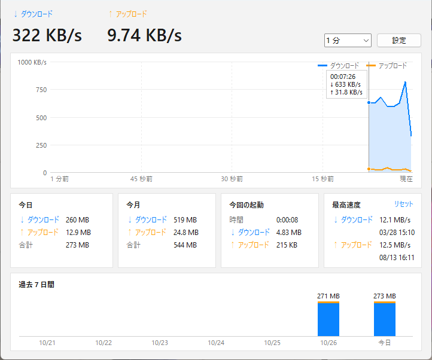
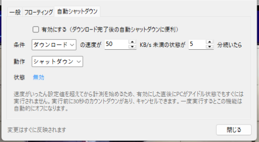

# ネット速度モニター（NetSpeed Monitor）

Python（tkinter + psutil）で作った Windows 向けの軽量なネットワーク速度モニターです。
タスクトレイに常駐し、小さなフローティングウィンドウに現在の速度を表示し、日ごとの通信量を記録します。

[English](README.md) | **日本語** | [中文](README.zh-CN.md)



## 主な機能

- **フローティングウィンドウ** – 1 行のコンパクト表示（`↓ 896 KB/s  ↑ 29.9 KB/s`）。数字の幅が固定なので、値が変わっても文字が左右に動きません。
  ダーク / ライトテーマ、不透明度の調整、画面端への吸着、マウスを重ねると今日の通信量を表示。

  
- **タスクトレイアイコン** – ダブルクリックでメイン画面、右クリックでメニュー。メイン画面を閉じてもトレイで動き続けます。
- **リアルタイムグラフ** – ダウンロードとアップロードを 1 つのグラフに表示し、縦軸は自動調整（1 / 5 / 15 分）。マウスを重ねるとその時点の値を確認できます。
- **通信量の統計** – 今日・今月・今回の起動・過去 7 日間、最高速度。
- **正確な集計** – 仮想アダプターや VPN（Hyper-V、TAP、WireGuard、Tailscale など）を自動で除外し、同じ通信を二重に数えません。
- **自動シャットダウン** – 速度が一定時間低いままのとき（ダウンロード完了後など）に、シャットダウン・再起動・スリープ・休止状態・サインアウトを実行。
  誤動作防止として、速度がいったん設定値を超えてから計測を始め、実行前に 30 秒のカウントダウン（キャンセル可）があります。

  
- **バイト / ビット表示** – MB/s、または回線プランと同じ Mbps で表示。
- **3 言語対応** – 日本語・English・中文。既定では Windows の表示言語に合わせます。
- **ファイル 1 つ** – インストール不要。設定と通信量はスクリプトと同じフォルダーの `netspeed.json` 1 つに保存します。

## 動作環境

- Windows 10 / 11
- Python 3.8 以降（Windows 11 + Python 3.14 で開発・動作確認）
- [psutil](https://pypi.org/project/psutil/)

## 使い方

```bash
pip install -r requirements.txt
pythonw netspeed.pyw
```

`pythonw` を使うとコンソールウィンドウが開きません。ダブルクリックで起動したい場合は、`pythonw.exe` を対象に
`netspeed.pyw` を引数にしたショートカットを作るか、**設定 → 一般 → Windows の起動時に自動で開始** をオンにしてください。

## 仕組み

| 項目 | 方法 |
|---|---|
| 速度 | Tk のタイマーで `psutil.net_io_counters(pernic=True)` を取得し、前回からのバイト数 ÷ 経過時間（`time.perf_counter`）で計算。カウンターのリセットやスリープ復帰時は、異常な値にならないよう無視します。 |
| アダプター名 | `ctypes` で `iphlpapi.dll` の `GetIfTable2` を呼び、「イーサネット」などの名前とハードウェア名を対応付けて、仮想アダプターを判別します。 |
| トレイアイコン | 隠しウィンドウと `ctypes` のウィンドウプロシージャで `Shell_NotifyIconW` を直接使用（追加パッケージ不要）。ウィンドウプロシージャは tkinter のメッセージ処理の内側で呼ばれるため、イベントをキューに積むだけにしています。そこから tkinter を呼ぶと、tkinter が保持するスレッド状態が消え、プロセスが異常終了するためです。 |
| 保存 | JSON ファイル 1 つ。一時ファイルに書いてから置き換えるので、書き込み中に落ちてもデータが壊れません。 |
| 表示 | Per-monitor DPI 対応で、125 % / 150 % 表示でも文字がぼやけません。Windows 11 では `DwmSetWindowAttribute` で角を丸くしています。 |

## プライバシー

このアプリはインターネットに接続しません。記録したデータはすべて PC 内の `netspeed.json` に保存されます。
それ以外に書き込むのはアイコンのキャッシュ（`%LOCALAPPDATA%\NetSpeedMonitor\netspeed.ico`）だけです。

## 謝辞

Tomosawa 氏の *NetworkSpeedMoniter 1.35*（2010 年）から着想を得ました。本プロジェクトは新しく書いた実装で、元のソフトのコードは含んでいません。

## ライセンス

[MIT](LICENSE)
