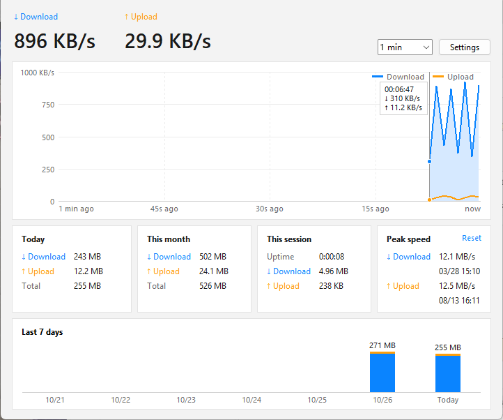
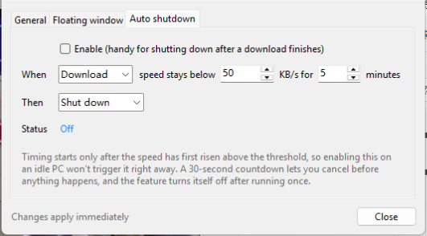

# NetSpeed Monitor

A lightweight network speed monitor for Windows, written in Python (tkinter + psutil).
It sits in the system tray, shows the current speed in a small floating window, and keeps a daily usage history.

**English** | [日本語](README.ja.md) | [中文](README.zh-CN.md)



## Features

- **Floating window** – one compact line (`↓ 896 KB/s  ↑ 29.9 KB/s`) with fixed-width numbers that don't jump around.
  Dark or light theme, adjustable opacity, snaps to screen edges, hover to see today's usage.

  
- **System tray icon** – double-click to open the main window, right-click for the menu. Closing the main window keeps the app running in the tray.
- **Live chart** – download and upload in one chart with an auto-scaling axis (1 / 5 / 15 minutes). Hover to read the exact values at any point.
- **Usage statistics** – today, this month, this session, the last 7 days, and peak speeds.
- **Accurate totals** – virtual and VPN adapters (Hyper-V, TAP, WireGuard, Tailscale, …) are skipped automatically, so the same traffic isn't counted twice.
- **Auto shutdown** – shut down, restart, sleep, hibernate or sign out when the speed stays low (e.g. after a download finishes).
  Two safeguards: timing starts only after the speed has first gone above the threshold, and a 30-second countdown lets you cancel.

  
- **Bytes or bits** – show MB/s, or Mbps as internet providers advertise.
- **Three languages** – English, 日本語 and 中文; follows the Windows display language by default.
- **One file** – no installer. Settings and usage live in a single `netspeed.json` next to the script.

## Requirements

- Windows 10 or 11
- Python 3.8 or later (developed and tested with Python 3.14 on Windows 11)
- [psutil](https://pypi.org/project/psutil/)

## Getting started

```bash
pip install -r requirements.txt
pythonw netspeed.pyw
```

`pythonw` runs the app without a console window. To start it with a double-click, create a shortcut to
`pythonw.exe` with `netspeed.pyw` as the argument, or turn on **Settings → General → Start with Windows**.

## How it works

| Part | Approach |
|---|---|
| Speed | `psutil.net_io_counters(pernic=True)` sampled on a Tk timer; bytes since the last sample ÷ elapsed time (`time.perf_counter`). Counter resets and resume-from-sleep are ignored instead of producing spikes. |
| Adapter names | `GetIfTable2` from `iphlpapi.dll` via `ctypes` maps names like "Ethernet" to hardware descriptions, which are used to recognise virtual adapters. |
| Tray icon | `Shell_NotifyIconW` with a hidden window and a `ctypes` window procedure – no extra packages. The window procedure runs inside tkinter's message dispatch, so it only queues events; calling tkinter from there clears tkinter's saved thread state and crashes the process. |
| Storage | One JSON file, written to a temporary file and then renamed, so a crash mid-write can't corrupt it. |
| Display | DPI-aware, so text stays sharp at 125 % / 150 % scaling (on a multi-monitor setup with different scaling, windows on the secondary monitor are scaled by Windows and may look slightly soft). Rounded corners on Windows 11 via `DwmSetWindowAttribute`. |

## Privacy

The app never connects to the internet. Everything it records stays in `netspeed.json` on your computer.
The only other file it writes is its icon, cached at `%LOCALAPPDATA%\NetSpeedMonitor\netspeed.ico`.

## Acknowledgements

Inspired by *NetworkSpeedMoniter 1.35* by Tomosawa (2010). This project is a new implementation and contains none of its code.

## License

[MIT](LICENSE)
