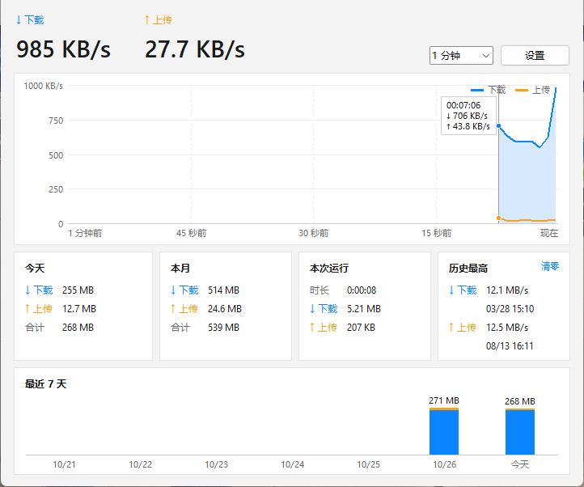
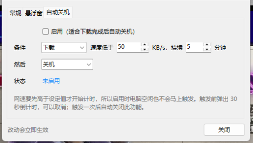

# 网速监控（NetSpeed Monitor）

用 Python（tkinter + psutil）编写的 Windows 轻量网速监控工具。
它常驻在系统托盘，用一个小悬浮窗显示实时网速，并按天记录流量。

[English](README.md) | [日本語](README.ja.md) | **中文**



## 功能

- **悬浮窗**：一行紧凑显示（`↓ 896 KB/s  ↑ 29.9 KB/s`），数字宽度固定，网速变化时文字不会左右跳动。
  可选深色、浅色主题，能调不透明度，拖到屏幕边缘会自动贴边，鼠标停留时显示今天的流量。

  
- **托盘图标**：双击打开主界面，右键弹出菜单。关闭主界面后程序继续在托盘运行。
- **实时曲线**：下载和上传画在同一张图里，纵轴自动缩放，可看最近 1、5、15 分钟。鼠标指到曲线上能看到那一刻的数值。
- **流量统计**：今天、本月、本次运行、最近 7 天，以及历史最高速度。
- **统计准确**：自动排除虚拟网卡和 VPN 网卡（Hyper-V、TAP、WireGuard、Tailscale 等），同一份流量不会算两次。
- **自动关机**：网速持续偏低时（比如下载完了），自动关机、重启、睡眠、休眠或注销。
  有两道保险：网速要先超过设定值才开始计时；执行前有 30 秒倒计时，可以取消。

  
- **字节或比特**：显示 MB/s，或者和宽带套餐一样的 Mbps。
- **三种语言**：中文、日本語、English，默认跟随 Windows 的显示语言。
- **只有一个文件**：不用安装。设置和流量记录都存在脚本旁边的 `netspeed.json` 里。

## 运行环境

- Windows 10 / 11
- Python 3.8 或更高版本（在 Windows 11 + Python 3.14 上开发和测试）
- [psutil](https://pypi.org/project/psutil/)

## 使用方法

```bash
pip install -r requirements.txt
pythonw netspeed.pyw
```

用 `pythonw` 运行不会弹出黑色的控制台窗口。想双击启动的话，可以建一个快捷方式：目标是 `pythonw.exe`，参数填 `netspeed.pyw`。
也可以在 **设置 → 常规 → 开机自动启动** 里打开开机启动。

## 实现原理

| 部分 | 做法 |
|---|---|
| 测速 | 用 Tk 的定时器定期读取 `psutil.net_io_counters(pernic=True)`，用“两次采样之间的字节数 ÷ 经过的时间（`time.perf_counter`）”算出速度。遇到计数器清零或从睡眠中恢复时，丢弃这一次的结果，避免出现异常的尖峰。 |
| 网卡名称 | 通过 `ctypes` 调用 `iphlpapi.dll` 的 `GetIfTable2`，把“以太网”这类名称对应到网卡型号，再根据型号识别虚拟网卡。 |
| 托盘图标 | 用一个隐藏窗口和 `ctypes` 写的窗口过程函数，直接调用 `Shell_NotifyIconW`，不依赖额外的库。窗口过程函数是在 tkinter 处理消息的过程中被调用的，所以它只把事件放进队列；如果在这里直接调用 tkinter，会清掉 tkinter 保存的线程状态，导致进程崩溃。 |
| 存储 | 只用一个 JSON 文件。先写到临时文件再替换，写到一半时程序崩溃也不会损坏数据。 |
| 显示 | 支持系统 DPI 缩放，系统缩放调到 125%、150% 时文字也不会发虚（多个显示器缩放比例不同时，副屏上的窗口由 Windows 拉伸显示，可能略微发虚）。在 Windows 11 上用 `DwmSetWindowAttribute` 给悬浮窗加了圆角。 |

## 隐私

程序不联网，记录的数据都保存在你电脑上的 `netspeed.json` 里。
除此之外，它只会写一个图标缓存文件：`%LOCALAPPDATA%\NetSpeedMonitor\netspeed.ico`。

## 致谢

灵感来自 Tomosawa 的 *NetworkSpeedMoniter 1.35*（2010 年）。本项目的代码全部是新写的，不包含原软件的任何代码。

## 许可证

[MIT](LICENSE)
